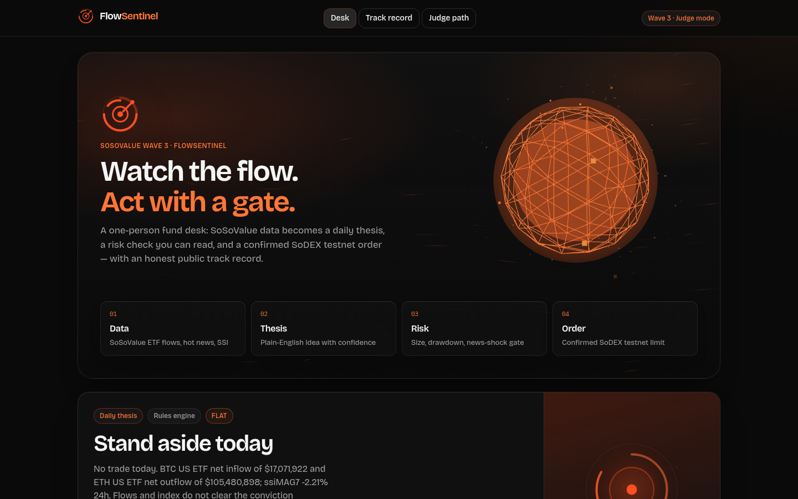
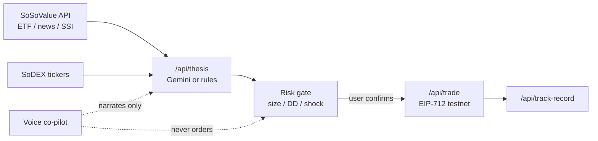

# FlowSentinel



**AI one-person fund desk** for the [AKINDO SoSoValue buildathon Wave 3](https://app.akindo.io/wave-hacks/JBEQXgN4Zi2jA3wA) — *Build Your One-Person On-Chain Finance Business with SoSoValue*.

SoSoValue ETF flows, hot news and ssiMAG7 become a daily thesis. A hard risk gate requires human confirm. Then a **SoDEX testnet EIP-712** order lands, and an honest track record logs the outcome. A voice co-pilot narrates the same ticket and never places orders.

| | |
| --- | --- |
| **Live preview** | https://flowsentinel-app.vercel.app |
| **60s judge path** | https://flowsentinel-app.vercel.app/judge |
| **Track record** | https://flowsentinel-app.vercel.app/track-record |
| **Branch** | `flowsentinel-wave3` (preview / PR — not production) |

No wallet. No login.

---

## 60-second judge path

1. Open **[/judge](https://flowsentinel-app.vercel.app/judge)** — auto walkthrough: Data → thesis → risk → confirm → receipt  
2. Or open the **Desk** (`/`) — FlowRadar, Live/Fallback panels, JARVIS ideas citing SoSoValue news  
3. Tick **Confirm** on the risk gate → place order (labelled **TESTNET LIVE** or **DRY-RUN SIMULATED**)  
4. Open **[/track-record](https://flowsentinel-app.vercel.app/track-record)** — thesis id, risk decision, order status, hit rate  

---

## SoDEX testnet proof (EIP-712)

FlowSentinel places **real SoDEX testnet** orders when `SODEX_ACCOUNT_ID`, `SODEX_API_KEY_NAME`, and `SODEX_API_KEY_PRIVATE_KEY` are set (Preview branch + Development only). Without keys the desk stays labelled **DRY-RUN SIMULATED**. Mainnet is hard-locked out. Server max notional **10 USDC** per confirmed order.

Proven on account `60539` (`testnet-gw.sodex.dev`, chainId `138565`):

| orderID | status | notes |
| --- | --- | --- |
| **1301914828** | FILLED / partial | MARKET IOC via `/api/trade` on live preview |
| **1301909841** | FILLED | MARKET IOC buy; trade `9461764`; 0.00005 vBTC @ 78619 |
| **1301909840** | NEW | LIMIT buy 0.001 @ 5000 (resting) |

Signing: `X-API-Key` = key name, `X-API-Sign` = `0x01` + EIP-712 signature from the API-key wallet, `X-API-Nonce` = ms timestamp. Domain: SoDEX spot `ExchangeAction`.

---

## Architecture



| Layer | Role |
| --- | --- |
| `lib/sosovalue.ts` | SoSoValue client (`x-soso-api-key`) + labelled fallbacks |
| `lib/sodex.ts` | SoDEX testnet EIP-712 spot orders (dry-run when keys absent) |
| `lib/signal.ts` | Deterministic flow → side scoring |
| `lib/thesis.ts` | Gemini wrapper → rules fallback |
| `lib/risk-engine.ts` | Pass/fail checks + position size |
| `lib/track-record.ts` | File-backed honest log (`data/track-record.json`) |

### SoSoValue endpoints used

Base: `https://openapi.sosovalue.com/openapi/v1`

| Method | Path | Use |
| --- | --- | --- |
| GET | `/etfs/summary-history?symbol=BTC\|ETH&country_code=US` | ETF net flows drive conviction |
| GET | `/news/hot` | Hot news + shock filter; cited in thesis |
| GET | `/indices/ssimag7/market-snapshot` | SSI momentum input |

### SoDEX endpoints used

Testnet: `https://testnet-gw.sodex.dev/api/v1/spot`

| Method | Path | Use |
| --- | --- | --- |
| GET | `/markets/tickers` | Spot marks (public) |
| POST | authenticated order batch | EIP-712 limit / market when keys set |
| cancel | authenticated | Free margin on resting limits |

App routes: `/api/thesis`, `/api/risk`, `/api/trade`, `/api/track-record`, `/api/soso/*`, `/judge`, `/demo`, `/track-record`.

---

## Setup

```bash
npm install
cp .env.example .env.local   # never commit secrets
npm run test
npm run dev                  # http://localhost:3000
npm run build                # must pass
```

| Var | Required for | If missing |
| --- | --- | --- |
| `SOSOVALUE_API_KEY` | Live ETF / news / SSI | Labelled **Fallback** panels |
| `GEMINI_API_KEY` | LLM thesis | Deterministic rules thesis |
| `SODEX_ACCOUNT_ID` | Testnet EIP-712 order | Labelled **DRY-RUN** |
| `SODEX_API_KEY_NAME` | Testnet EIP-712 order | Labelled **DRY-RUN** |
| `SODEX_API_KEY_PRIVATE_KEY` | API-key wallet pk | Labelled **DRY-RUN** |
| `NEXT_PUBLIC_APP_URL` | Absolute links | Preview URL |

Secrets for this buildathon live outside the repo (gitignored). Preview/Dev env only on Vercel — not Production.

To register a **testnet** API key on your own PC (never on a shared agent box):

```bash
npx tsx scripts/register-testnet-api-key.ts
```

---

## Security notes

- Mainnet trading path is **hard-locked out** in code
- Server enforces max notional **10 USDC** even after UI confirm
- Voice / JARVIS **cannot** place orders — explicit checkbox + click required
- No secrets in client bundles; SoDEX private key is server-only
- Soft API rate limit + security headers on responses
- DRY-RUN vs TESTNET LIVE labelled everywhere judges look

---

## Voice desk

- English TTS: Kokoro-82M (in-browser); other languages: Piper / Web Speech
- STT: Whisper tiny when loaded, else Web Speech
- Commands: “read thesis”, “explain risk”, “ETF flows”, “news”
- Continuous VAD conversation; Mute + barge-in; never places orders

---

## Brand

| Hex | Source |
| --- | --- |
| `#FF4F20` | SoSoValue primary |
| `#FF7637` | SoDEX accent |
| `#0A0A0A` / `#121212` / `#171717` | Ink |
| `#1EA858` / `#F24237` | Gain / loss |

Assets: `public/brand/`. Screenshots: `docs/hero.png`, `docs/desk.png`.

---

## Tests

- `tests/risk-engine.test.ts` — sizing, geometry, shock pause, drawdown
- `tests/signal.test.ts` — flow scoring, LONG/SHORT/FLAT, thesis text

---

## Roadmap

1. Persist track record to durable storage with signed decision hashes  
2. Optional Telegram one-tap **confirm** (still human-gated; no autonomous fire)  
3. Broader SoSoValue surface (macro events) inside the same risk object  
4. Mainnet only after explicit user unlock + higher caps — out of scope for Wave 3  

See `CHANGELOG.md` for Wave 3 detail. License: MIT (`LICENSE`).

---

## Design credits (inspiration only)

| Resource | License | Inspiration |
| --- | --- | --- |
| shadcn/ui · Magic UI · Origin UI | MIT | Panels, motion, dense chrome |
| Tremor | Apache-2.0 | Metric hierarchy |
| Motion (`framer-motion`) | MIT | Springs / reduced-motion |
| three.js · R3F · drei | MIT | Voice orb / hero field |
| kokoro-js · Piper · transformers.js | Apache-2.0 / MIT | Free TTS / STT |

FlowSentinel code is original; we did not vendor proprietary component source.
